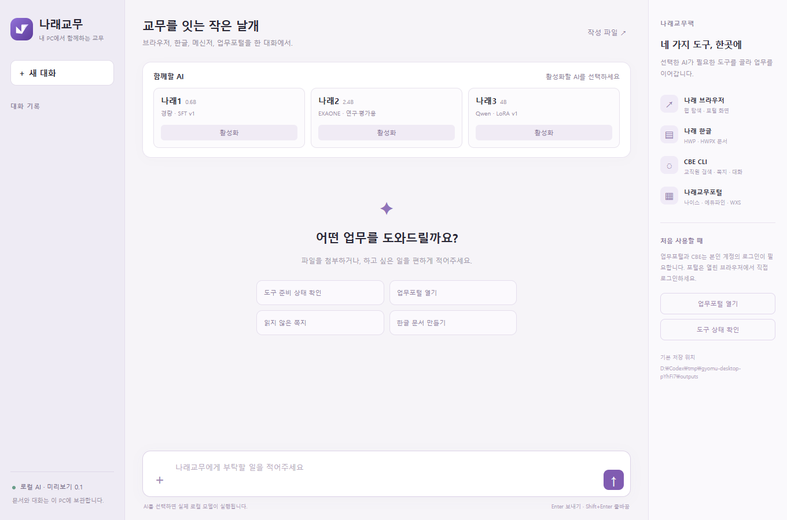

# 나래교무

**나래 브라우저 + 나래 한글 + CBE CLI + 나래교무포털을 하나의 Windows 프로그램과 CLI로 연결합니다.** 나래1·나래2·나래3 중 하나의 실제 로컬 모델을 활성화하고 채팅으로 업무를 요청합니다. 다른 AI는 같은 CLI를 직접 사용할 수 있습니다.

나래4는 설치된 나래 한글 오피스의 로컬 에이전트로 연결합니다. `narae-gyomu office agent-status`로 확인하고 `narae-gyomu office agent JOB.json --result RESULT.json`으로 실행합니다. JOB 예시는 `{"prompt":"받은 쪽지 최근 3건 요약","workspace":"D:/Codex/workspaces/교무자료","model":"narae4","allowChanges":false}`입니다. 문서 변경·브라우저 이동/입력이 필요한 요청은 `allowChanges:true`를 지정합니다. 이 연결은 세 모델 데몬을 새로 띄우지 않으며 나래4가 있는 오피스 설치본이 필요합니다. 자세한 [스킬 안내](skills/narae-gyomu/SKILL.md)를 확인하세요.



## 바로 사용

[미리보기 배포 파일](https://github.com/y5496694/narae-gyomu/releases/tag/v0.1.0-preview.1)에서 `Download-NaraeGyomu.ps1`을 내려받아 PowerShell로 실행합니다. 분할된 파일을 자동으로 내려받고 SHA-256 확인·합치기·설치까지 진행합니다.

```powershell
.\Download-NaraeGyomu.ps1
```

기본 설치 위치는 `D:\Codex\apps\NaraeGyomu`, 개인 자료는 `D:\Codex\narae-gyomu-data`입니다. 이미 설치 폴더가 있으면 보존하며 새 `-Destination`을 지정합니다. GitHub 소스 ZIP에는 소스·스킬·템플릿만 있고, **배포 분할 파일에는 세 모델 가중치·어댑터·AI 실행기·Python·데스크톱 실행 환경도 들어 있습니다.** ChatGPT 계정·유료 AI API·별도 Ollama 설치는 필요하지 않습니다.

1. `NaraeGyomu.exe` 또는 `나래교무 시작.cmd`를 실행합니다.
2. 나래1·나래2·나래3 중 **활성화** 버튼 하나를 누릅니다. 이전 AI가 종료된 뒤 새 AI만 실행됩니다.
3. 채팅으로 요청하거나 **＋**로 업무 파일을 선택합니다.
4. 업무포털은 나래 브라우저 창에서, CBE는 기존 메신저 앱에서 직접 로그인합니다.
5. 문서 결과는 **작성 파일**에서 확인합니다. 실제 연락·WXS 적용은 구체적인 미리보기를 확인한 뒤 적용합니다.

Windows 10/11 x64, Chrome 또는 Edge, 모델을 실행할 여유 메모리가 필요합니다. 이 PC의 16GB RAM·CPU 환경에서 검증했습니다. 실제 업무에는 본인에게 설치·허가된 충북소통메신저, 업무포털 보안 구성요소와 WXS Client가 필요합니다. 이 팩이 타사 앱·계정·인증서를 대신 배포하지 않습니다.

## 세 로컬 AI

| 선택 | 실제 모델 | 포함한 학습 결과 |
|---|---|---|
| 나래1 · 0.6B | Qwen3-0.6B | SFT v1, v2 회귀 버전은 채택하지 않음 |
| 나래2 · 2.4B | **EXAONE**-3.5-2.4B-Instruct | 실제 Tool SFT v2 · 연구·평가용 |
| 나래3 · 4B | Qwen3-4B-Instruct-2507 | 실제 LoRA v1 · 실험 버전 |

프롬프트 이름만 바꾼 모델이 아닙니다. 실제 GGUF base와 학습 어댑터를 함께 로드하고 파일 해시·실행 이름·어댑터 강도를 확인합니다. 모델 설명과 해시는 [catalog](models/catalog.json)에 있습니다. 세 모델의 기존 전체 모의 벤치 성능은 낮으며 복잡한 실무의 자동 완수를 보장하지 않습니다. [기존 측정](https://github.com/y5496694/narae_bench)과 이 프로그램의 연결 시험은 구분합니다.

**나래2는 EXAONE의 연구·평가용 이용조건을 따릅니다.** 통상 업무·상업적 배포 전에는 원본 이용조건과 별도 허용 여부를 확인해야 합니다. Qwen 모델은 Apache-2.0 조건입니다. 팩 전체를 제한 없는 단일 모델 라이선스로 배포하는 것이 아닙니다. [모델 이용조건](licenses/models/)과 [EXAONE 원문](https://huggingface.co/LGAI-EXAONE/EXAONE-3.5-2.4B-Instruct/blob/main/LICENSE)을 보관합니다.

## 네 도구가 실제로 연결되는 방법

| 구성 | 연결 |
|---|---|
| [나래 브라우저](https://github.com/y5496694/narae_browser) | 원본 Playwright 엔진 + 업무 화면의 iframe·현재 값·체크 상태 관찰 보강 |
| [나래 한글](https://github.com/y5496694/Narae_hangul_office) | 나래 한글 오피스 CLI로 HWP/HWPX 읽기·생성·보존 편집, 실제 저장 후 재열람 검증 |
| [CBE CLI](https://github.com/y5496694/CBE_CLI) | 원본 CLI로 교직원 검색·쪽지·대화 조회·전송 사전 점검과 확인된 전송 |
| [나래교무포털](https://github.com/y5496694/narae_gyomoo_portal) | 영역별 절차 + 나래 브라우저의 실제 화면 제어 + 열린 WXS의 원본 CLI |

나이스·에듀파인에는 직접 로그인한 뒤 실제 화면을 확인하고 진행합니다. 대상 문서와 작업을 명시한 상신·결재 승인은 문서·결재선·첨부 지문과 기존 권한을 확인하는 별도 최종 처리 경로로 지원합니다. 초안·조회·임시저장만 요청하면 상신하지 않으며, 공문 발송은 지원하지 않습니다. 독립 한글 엔진은 모든 문서의 조판·쪽수·픽셀 일치를 보장하지 않으며, 형식 간 변환은 이 경로에서 지원하지 않습니다. 고급 HWP 표 편집 등은 원본이 요구하는 한컴 환경이 필요할 수 있습니다.

이름 검색 결과와 문단·창 ID를 관찰한 뒤 사용합니다. 임의 셸·Python·페이지 JavaScript를 모델 도구로 제공하지 않습니다. 연락·공문 적용 미리보기는 완료가 아니며, 불확실한 전송을 재시도하지 않습니다. 간단한 상태 확인·단일 문서 생성·포털 열기는 모델이 고른 실제 도구 결과를 실행기가 바로 표시해 반복 호출을 막습니다. 이런 결과 표시는 모델의 자유 작성 성능 측정이 아닙니다.

## CLI와 외부 AI

배포 폴더의 `install.ps1`은 D:에 CLI와 스킬을 설치합니다. 기존 스킬은 백업하고 Codex에는 호환 junction으로 연결합니다. 전역 AGENTS.md를 바꾸지 않습니다. 새 터미널과 새 AI 대화에서 사용합니다.

```powershell
narae-gyomu doctor
narae-gyomu schema
narae-gyomu models activate narae3
narae-gyomu chat "업무포털을 열어줘" --json
narae-gyomu tool call system.status --args '{}'
narae-gyomu tool call hangul.inspect --args-file inspect.json --file 'D:\업무\문서.hwpx'
```

`tool call`은 로컬 AI를 거치지 않고 외부 AI가 같은 실제 도구를 사용하는 경로입니다. 복잡한 JSON·여러 줄 원문은 `--args-file`로 전달합니다. [통합 스킬](skills/narae-gyomu/SKILL.md)과 [CLI 예시](skills/narae-gyomu/references/cli.md)를 참고하세요. 기본 교육청 주소를 바꿀 때는 개인 자료 폴더의 `portal.json`에 `region`, 확인된 `portal_url`을 지정합니다.

## 소스·시험

원본 네 저장소는 `packages/`에 실제 파일로 포함합니다. [sources.lock.json](sources.lock.json)의 커밋·224개 파일 해시로 대조하며 원본을 덮어쓰지 않고 통합 코드를 `src/`에 둡니다. [만승교무팩](https://github.com/y5496694/mansung-gyomu-pack)의 영역별 분류·스킬 설치 구조를 참고했습니다. 이지에듀·하이클래스·시간표는 이번 네 도구 범위에 추가하지 않았습니다.

```powershell
npm ci
node node_modules/electron/install.js
npm test
npm run vendor:verify
# Windows에서 포함 런타임을 준비한 경우 실제 로컬 브라우저·한글·화면 시험
npm run test:e2e
npm start
```

개발용 `scripts/prepare-local.py`는 이 PC의 D:에 이미 검증해 둔 실제 학습 산출물을 묶는 스크립트입니다. 다른 PC에서 학습 폴더를 자동 생성하는 설치기가 아닙니다. 일반 사용자는 가중치가 포함된 배포 파일을 사용합니다. [검증 기록](verification/)에는 로컬 합성 문서·모의 전송·실제 모델 연결 시험을 구분해 남깁니다. 학교 계정 로그인·시험 메시지·실제 공문 생성을 설치 검증으로 수행하지 않았습니다.

대화·문서·쿠키·인증정보·API 접속 토큰은 공개 배포본에 포함하지 않습니다. 사용 중 생성되는 개인 자료는 별도 D: 폴더에 남으며 모델 학습 자료로 수집하지 않습니다. 이 배포본은 코드서명이 없는 미리보기 버전입니다.

한글 문서 작업은 [나래 한글 오피스](https://github.com/y5496694/Narae_hangul_office)의 CLI로 실행합니다. 한컴오피스 한글을 먼저 설치한 뒤 오피스의 설치.cmd를 한 번 실행하세요. 별도 경로는 NARAE_OFFICE_ROOT로 지정합니다. 기존 독립 뷰어는 사용하지 않습니다. 편집에는 직전 inspect의 input_sha256을 전달합니다.
