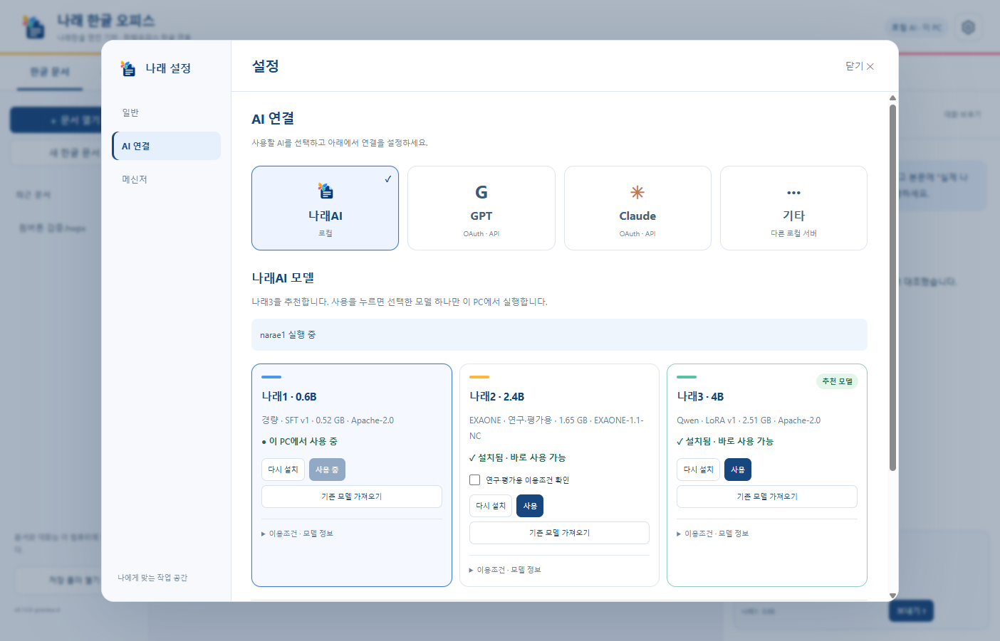

# 텔레그램과 나래AI

## 나래AI 모델



`설치.cmd`가 공식 llama.cpp CPU 실행기를 SHA256 확인 후 준비합니다. 모델 가중치는 앱에 동봉하지 않습니다. **설정(⚙) → AI 연결 → 나래AI**에서 원하는 모델의 **설치**를 누르면 Hugging Face의 고정 버전에서 가중치와 학습 어댑터를 받습니다. 진행률·취소·해시 검사를 제공하며 **사용**을 누르면 이전 모델을 종료하고 선택한 모델 하나를 실행합니다. 모델 이름·실제 어댑터·적용 강도를 확인합니다. 계정·API 키·GPU 도구는 필요 없습니다.

| 모델 | 기반 | 다운로드 | 이용조건 |
|---|---|---:|---|
| 나래1 | Qwen3 0.6B SFT v1 | 약 0.52 GB | Apache-2.0 |
| 나래2 | EXAONE 3.5 2.4B Tool SFT v2 | 약 1.65 GB | EXAONE 1.1 NC · 연구·평가용 |
| 나래3 | Qwen3 4B LoRA v1 | 약 2.51 GB | Apache-2.0 |

나래3은 **추천 모델**로 표시하며 기본 모델로 강제하지 않습니다. 기존 모델 선택을 유지합니다. 나래AI의 모델과 기타 로컬 서버 주소·모델은 따로 기억합니다. 실제 학습 가중치와 어댑터이며 프롬프트 프로필이 아닙니다. 나래2는 [EXAONE 이용조건](https://huggingface.co/LGAI-EXAONE/EXAONE-3.5-2.4B-Instruct/blob/main/LICENSE)을 먼저 확인합니다. 모델 크기 외에도 실행 메모리와 임시 디스크 공간이 필요합니다. 세 모델은 실험용이며 복잡한 업무의 자율 완수나 모든 문서의 정확성을 보장하지 않습니다. 같은 도구를 반복하는 응답과 잘린 응답을 완료로 처리하지 않습니다.

모델은 앱 데이터 폴더의 `models`에 저장합니다. 모델 화면의 **모델 저장 폴더 변경**으로 다른 드라이브의 폴더를 선택할 수 있으며, 선택한 위치는 다음 실행에도 유지합니다. 기존 파일은 자동 이동·삭제하지 않습니다. 개발·검증용 `NARAE_AI_MODELS` 환경변수가 있으면 그 위치를 우선합니다.

**사용**으로 선택한 모델과 자동 실행 설정을 기억합니다. 다음에 앱을 열면 마지막으로 선택한 로컬 모델을 준비합니다. 자동 실행 체크를 끄거나 **실행 중인 AI 중지**를 누르면 다음 실행에 자동으로 켜지지 않습니다. 다른 모델을 다시 **사용**하면 자동 실행이 켜집니다. 모델 로딩 중 들어온 같은 모델의 요청은 로딩을 함께 기다립니다. 나래교무에서 받은 모델은 **기존 모델 가져오기**로 `base.gguf`·`adapter.gguf`가 있는 폴더를 선택합니다. 원본을 그대로 두고 복사하며 등록된 크기·SHA256과 일치해야 합니다.

**설정 → AI 연결 → 기타**의 **다른 로컬 AI 서버 연결**에서는 Ollama·LM Studio 등 OpenAI 호환 서버의 `/v1` 주소와 모델 ID를 입력합니다. 이 컴퓨터의 loopback HTTP 주소만 허용하며 JSON Schema 형식의 Chat Completions를 지원해야 합니다. 선택한 AI는 도구를 결정하고 실제 문서 작업은 기존 나래한글 엔진이 수행합니다.

## 텔레그램

1. **설정(⚙) → 메신저 → 텔레그램** → **BotFather 열기**에서 전용 봇을 만들고 토큰을 앱에 입력합니다. 토큰을 대화나 GitHub에 올리지 마세요.
2. **내 계정 연결 링크 만들기** → **텔레그램에서 연결**을 누릅니다. 링크는 10분간 한 번만 사용합니다. 개인 채팅 하나만 연결하고 그룹·다른 계정의 요청은 실행하지 않습니다.
3. 업무 요청이나 HWP·HWPX 파일을 보냅니다. 선택한 OAuth/API/로컬 AI가 동일한 에이전트를 실행합니다. 문서 변경·브라우저 조작·발송은 구체적인 PC 승인 뒤 수행합니다.
4. 응답과 생성·수정·PDF 파일을 텔레그램으로 받습니다. PC 에이전트 탭의 대화 선택에서 텔레그램 기록도 볼 수 있습니다.

- `/files`: 작업 폴더의 문서 목록 (최대 50개)
- `/get 파일명`: 작업 폴더 안의 HWP·HWPX·PDF 받기
- `/cancel`: 진행 중인 텔레그램 작업 중지
- `/help`: 사용 안내

PC 앱이 켜져 있어야 합니다. 공인 서버나 포트 개방은 필요 없습니다. 이미 웹훅에서 사용 중인 봇은 연결하지 않으며 기존 웹훅을 삭제하지 않습니다. 토큰은 Windows 사용자 암호화 저장소에 보관하므로 다른 PC에서는 다시 연결합니다.

첨부와 응답은 Telegram 서버를 거칩니다. 첨부 수신은 HWP/HWPX 20MB 이하, 파일 전송은 50MB 이하입니다. 요청 ID와 상태를 저장해 재전송·재시작으로 같은 수정을 반복하지 않습니다. 중단 전 완료된 변경은 남을 수 있습니다. [공식 Bot API](https://core.telegram.org/bots/api)를 사용합니다.

## 개발자: 모델 배포

공식 `huggingface_hub`가 설치된 Python과 본인 로그인이 필요합니다.

```powershell
hf auth login
python scripts/publish-models.py --source "나래교무 폴더" --namespace "허깅페이스 아이디"
```

등록된 가중치·어댑터를 해시 검사하고 모델별 공개 저장소에 두 GGUF·모델 카드·이용조건·매니페스트만 올립니다. 학습 데이터·대화·사용자 문서·자격 증명은 업로드하지 않습니다. 성공한 commit ID를 `resources/local-models.json`에 기록하므로 이를 포함해 앱을 배포합니다. `--prepare-only --staging-root 폴더`로 업로드 전 구성을 확인할 수 있습니다.

파일 이름 하나를 명시한 단순 생성 요청은 엔진의 저장·재읽기 확인 결과로 종료해 작은 모델의 같은 생성 반복을 방지합니다. 이 확인 문장은 모델의 자율 업무 성능 점수가 아닙니다. 여러 단계 요청과 PDF·전송 등 후속 요청은 계속 처리합니다.
